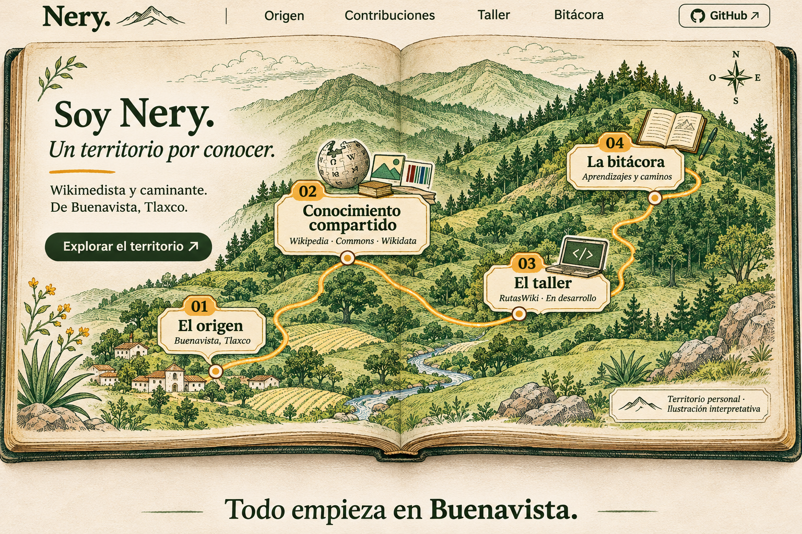
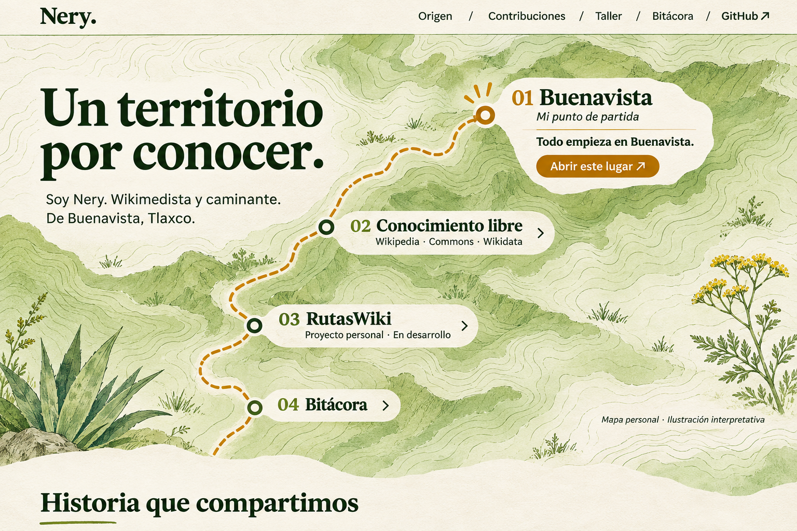
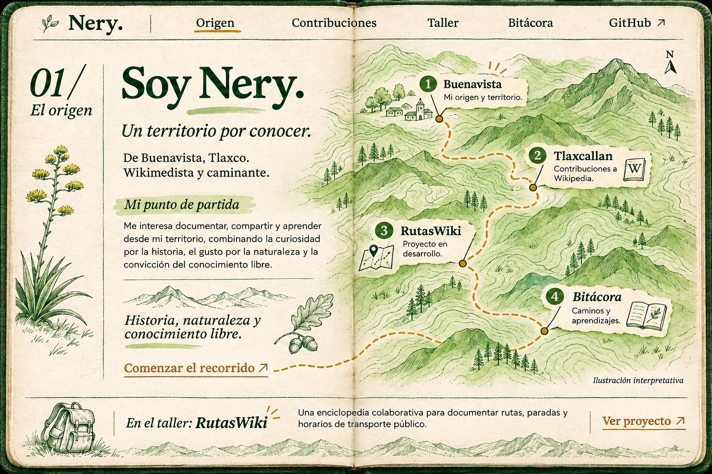

# Nery · Referencias de la primera pantalla

Tres propuestas de composición de la identidad aprobada, generadas con image_gen.imagegen. Ninguna está aprobada todavía. Son referencias visuales; no existe implementación del sitio aún.

## 1. Atlas abierto

Paisaje ilustrado envolvente con cuatro destinos visibles. Mayor protagonismo de la exploración.

## 2. Sendero continuo

Cartografía ligera, entradas despejadas y continuidad con las secciones siguientes. Recomendación inicial por legibilidad y adaptación al celular.

## 3. Cuaderno desplegado

Una doble página que une presentación personal y mapa. La materialidad del cuaderno domina la experiencia.

## Siguiente decisión

Elegir, combinar, revisar o rechazar. Registrar la aprobación explícita de Nery en el sidecar correspondiente y el surface brief antes de avanzar a la especificación y el código. No confundir estas ilustraciones con cartografía exacta ni con fotografías documentales de Buenavista.

Los prompts completos y la procedencia están en los archivos .prompt.txt y .png.json junto a las imágenes. La tercera referencia recibió una edición para corregir la descripción de RutasWiki como transporte público.
